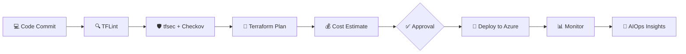

<!-- Replace YOUR_GITHUB_USERNAME, YOUR_LINKEDIN, and YOUR_EMAIL before publishing -->

 

---

## 👨‍💻 About Me

I'm a **Lead DevSecOps Engineer** who designs and automates secure, scalable and cost-optimized cloud platforms. My work spans **Cloud Infrastructure, DevOps, DevSecOps and Database Administration**, and I specialize in two things that matter in every cloud engagement: **security** and **cost optimization**.

- 🏛️ **Azure Landing Zones** and Hub & Spoke architecture
- 🏗️ **Terraform** Infrastructure as Code with reusable, governed modules
- 🔐 **Cloud security**: shift-left scanning, policy as code, secrets hygiene and least-privilege design
- 💰 **Cost optimization / FinOps**: cost estimation in pipelines, right-sizing and cost-aware architecture
- 🔁 **CI/CD automation** with security and cost gates built into every pipeline
- ☸️ **Kubernetes / AKS, Container Apps and Web Apps** for production workloads
- 📊 **Observability** with Azure Monitor, Datadog, Prometheus and Grafana

> 🚀 **Currently exploring:** **AIOps** and **MLOps**, while learning **LLMs, RAG (Retrieval-Augmented Generation) and MCP (Model Context Protocol)** to build intelligent, agent-driven infrastructure automation.

---

## 🎯 Why Work With Me

| Strength | What I Bring |
|---|---|
| **Security expertise** | Shift-left scanning (TFLint, tfsec, Checkov), policy and governance, approval-gated production changes and secure-by-default architecture |
| **Cost optimization** | Cost estimation before deployment, right-sized resources and FinOps-driven design decisions |
| **Architecture** | Enterprise-grade Azure Landing Zones with proper network segmentation, HA and DR |
| **Automation** | Fully codified infrastructure: repeatable, reviewable, version-controlled |
| **Full-stack ops** | From cloud networking to Kubernetes to database administration |
| **AI-ready mindset** | Applying AIOps, MLOps, LLMs, RAG and MCP to make operations smarter and faster |

---

## 🛠️ Technology Stack

<table>
<tr>
<td width="50%" valign="top">

### ☁️ Cloud & Architecture

</td>
<td width="50%" valign="top">

### ⚙️ DevOps & IaC

</td>
</tr>
<tr>
<td width="50%" valign="top">

### 🔐 Security (Expert)

</td>
<td width="50%" valign="top">

### 💰 Cost Optimization (Expert)

</td>
</tr>
<tr>
<td width="50%" valign="top">

### 🐳 Containers & Kubernetes

</td>
<td width="50%" valign="top">

### 📊 Monitoring & Databases

</td>
</tr>
<tr>
<td colspan="2" valign="top">

### 🤖 Exploring & Learning: AIOps, MLOps, LLMs, RAG, MCP

</td>
</tr>
</table>

---

## 🏗️ Featured Engineering Projects

### 1️⃣ Azure Monolithic Infrastructure & Landing Zone
**Stack:** `Terraform` `Azure` `Remote State`

- Enterprise-style Azure environment built entirely with Terraform
- Reusable modules for resource groups, networking, subnets, VMs and security resources
- Separate **Dev / QA / Prod** environments with consistent configuration
- Remote state management and automated infrastructure validation

### 2️⃣ DevSecOps CI/CD Pipelines
**Stack:** `Azure DevOps` `GitHub Actions` `TFLint` `tfsec` `Checkov`

- Automated Terraform `init`, `validate` and `plan` stages
- Security scanning with **TFLint, tfsec and Checkov** on every change
- Pull request validation and controlled deployments
- **Manual approval gates** for production changes

### 3️⃣ Docker, Kubernetes, Container Apps & Web Apps Delivery
**Stack:** `Docker` `ACR` `AKS` `Helm` `Azure Container Apps` `Azure Web Apps`

- Container image build and push workflows into Azure Container Registry
- Kubernetes Deployments, Services, Ingress and autoscaling (HPA/VPA)
- Application hosting on **Azure Container Apps** and **Azure Web Apps (App Service)**
- End-to-end automated application delivery through CI/CD

### 4️⃣ Security, Observability & Cost Optimization
**Stack:** `Azure Monitor` `Log Analytics` `Datadog` `Prometheus` `Grafana` `Terraform`

- Security-first design: network segmentation, policy and governance, least privilege and secret scanning
- Infrastructure and application monitoring with **Azure Monitor and Log Analytics**
- Metrics collection with **Prometheus** and dashboards and alerting in **Grafana**
- Full-stack observability and alerting with **Datadog**
- Terraform-based cost estimation before deployment
- Right-sizing, autoscaling and cost-aware architecture decisions

### 5️⃣ AIOps & MLOps *(Exploring)*
**Stack:** `AIOps` `MLOps` `Automation` `Observability Data`

- Exploring AIOps for anomaly detection, noise reduction and faster incident response
- Learning MLOps practices: model lifecycle, versioning, deployment pipelines and monitoring
- Applying DevSecOps discipline (security gates, approvals, cost control) to ML and AI workloads

### 6️⃣ LLMs, RAG & MCP for Infrastructure Automation *(Learning in Progress)*
**Stack:** `LLMs` `RAG` `MCP` `AI Agents`

- Learning how **LLMs** can assist with troubleshooting, code review and incident analysis
- Exploring **RAG** to ground AI answers in runbooks, documentation and infrastructure context
- Learning **MCP (Model Context Protocol)** to connect AI agents safely to cloud and DevOps tools
- Building towards AI agents for DevOps workflows with guardrails and human approval

---

## 🔄 How I Build: My DevSecOps Flow

---

## 🎯 Current Focus

- 🏛️ Enterprise Azure Landing Zone architecture
- 📦 Terraform module design and governance
- 🔐 Secure CI/CD and DevSecOps automation
- 💰 Cloud cost optimization and FinOps
- ☸️ Kubernetes and container orchestration
- 🤖 AIOps and MLOps
- 🧠 Learning LLMs, RAG and MCP

---

## 📈 GitHub Stats

---

## 🤝 Let's Connect

I'm open to conversations on **cloud security, cost optimization, DevSecOps, infrastructure automation, Kubernetes, AIOps, MLOps and AI-driven operations**.

**Building infrastructure. Securing the cloud. Optimizing cost. Exploring intelligent operations.**

