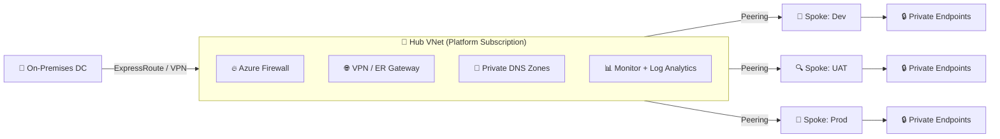
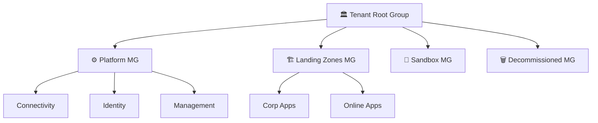
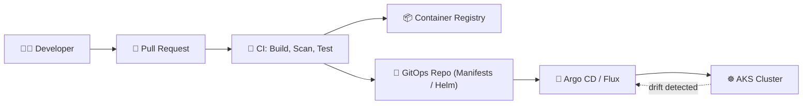
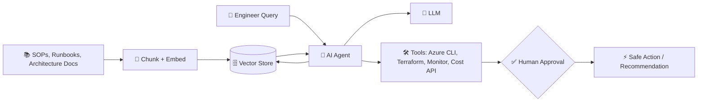
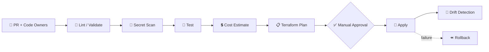

 

---

## 👋 About Me

> *"Build it **secure**, build it **repeatable**, build it **right the first time**."*

I'm a **Cloud & DevSecOps professional** who designs, automates and governs enterprise-scale cloud platforms. My work spans **architecture, migration, automation, security, cost optimization and technical leadership**: from the first discovery workshop to hypercare and knowledge transfer.

- 🏗️ Architecting **Azure Landing Zones** aligned to the **Cloud Adoption Framework (CAF)**
- 🔄 Leading **cloud migrations of 100+ applications** across Dev, UAT & Production
- ⚙️ Building **Terraform-driven, pipeline-gated** infrastructure with built-in security
- 🛡️ Embedding **governance, compliance, backup, DR & monitoring** by design
- ☸️ Running **containerized workloads on Kubernetes** with **GitOps-driven** delivery
- 🤖 Exploring **LLMs, RAG and Agentic AI** to bring intelligence into DevSecOps, FinOps and cloud operations
- 🤝 Managing **vendors, presales, proposals, POCs and delivery teams**

---

## 🧰 Tech Stack & Tools

**🤖 AI & Agentic Stack (Exploring)**

| Domain | Focus Areas |
|---|---|
| ☁️ **Cloud Architecture** | Landing Zones, Hub & Spoke, Management Groups, Subscription Design |
| 🔐 **Security** | Entra ID, RBAC, Defender for Cloud, Azure Policy, Private Endpoints |
| 🧱 **IaC & Automation** | Terraform modules, remote state, drift detection, policy-as-code |
| ☸️ **Containers & GitOps** | Docker, Kubernetes (AKS), Helm, Argo CD / Flux, policy & admission control |
| 🤖 **AI & Agentic** | LLMs, RAG, vector search, AI agents, MCP, AIOps / FinOps automation |
| 🚀 **CI/CD** | Azure Repos, multi-stage YAML pipelines, approvals, rollback |
| 📊 **Operations** | Azure Monitor, Backup, DR, HA, Observability |
| 💰 **FinOps** | Rightsizing, reservations, idle resource cleanup, log cost control |

---

## 🏛️ What I Do

<b>☁️ Cloud Architecture & Landing Zone</b>

 

- **Tenant & Management Group hierarchy**: Tenant Root → Platform MG, Landing Zones MG, Sandbox MG, Decommissioned MG
- **Subscription design**: platform vs. application subscriptions with clear boundaries
- **Azure Policy & Initiatives** at MG scope, with documented **policy exemptions & justifications**
- **RBAC group model** (least privilege) plus **subscription onboarding/offboarding** process
- **CAF-aligned strategy**: Plan → Ready → Adopt → Govern → Secure → Manage

<b>🌐 Hub & Spoke Networking</b>

 

- Centralized inspection, shared connectivity and **controlled egress** via Azure Firewall
- **IP address management (IPAM)** & on-prem CIDR assessment to avoid overlaps
- Hub VNet best practices with spoke **peering**, **UDRs** and firewall rule design
- **Private DNS Zones**, **Private Endpoints**, **VPN Gateway** & **ExpressRoute**
- Security applied at every layer: **Identity → Network → Governance → Compute**

<b>⚙️ Terraform & Landing Zone Automation</b>

 

- Secure **remote state** with least-privilege access and encryption at rest
- **Reusable modules**, linting, secret scanning, automated testing & cost estimation
- **Manual approval gates** and scheduled **drift detection** pipelines
- Middleware setup using **custom data scripts**

<b>🔁 Azure Repos & DevSecOps Pipelines</b>

 

- **Trunk-based** branching with short-lived feature branches
- Branch policies: mandatory PRs, max reviewers, **CODEOWNERS**, **no deletion of `main`**
- Reusable pipeline templates: `Validate & Test` → `Build` → `Deploy` → `Apply` → `Rollback`
- Parallel jobs for faster, safer delivery

<b>☸️ Containers, Kubernetes & GitOps</b>

 

- **Docker**: secure image builds, multi-stage Dockerfiles, image scanning, private registry (ACR)
- **Kubernetes / AKS**: cluster design, namespaces, RBAC, network policies, ingress, autoscaling
- **Helm** charts and reusable manifests for consistent application packaging
- **GitOps** with **Argo CD / Flux**: Git as the single source of truth, auto-sync and drift correction
- Secure supply chain: image scanning, secrets via Key Vault, policy enforcement at admission
- Modernizing VM-based apps into **containerized, portable workloads**

<b>🤖 AI, LLMs, RAG & Agentic AI (Exploring & Building)</b>

 

- **LLMs**: prompt engineering and enterprise use via **Azure OpenAI** and other model APIs
- **RAG**: grounding LLMs on internal runbooks, SOPs, architecture docs and policies using embeddings and vector search
- **Agentic AI**: tool-using agents that can read, reason and act on cloud and DevOps workflows (with human approval gates)
- **AIOps ideas**: AI-assisted incident triage, pipeline failure analysis, Terraform plan review
- **FinOps with AI**: natural-language cost insights and automated rightsizing recommendations
- **Responsible AI**: private endpoints, data privacy, access control and guardrails for AI workloads

<b>🚚 Cloud Migration & App Modernization</b>

 

- End-to-end lifecycle: **Discovery → Assessment → Readiness → Migration → Cutover → Hypercare**
- Migration strategy selection (Rehost / Replatform / Refactor / Retire)
- Pre-, during- and post-cutover **checklists** for predictable outcomes
- Hybrid estates: **on-prem datacenter + multi-subscription Azure**

<b>🛡️ Governance, Backup, DR & Monitoring</b>

 

- Backup retention policies, **RTO / RPO** planning, primary + secondary region design
- Storage redundancy choices: **LRS, ZRS, GRS**; compute resiliency with **VMSS** & Availability Zones
- Central monitoring and observability with **Azure Monitor** and Log Analytics
- Compliance via policy, Defender for Cloud and audit-ready documentation

<b>💰 FinOps & Cost Optimization</b>

 

- Identify **idle resources**, **unattached disks** and **oversized VMs**
- Cut unnecessary **log ingestion** costs
- **Auto start/stop** schedules for non-prod VMs
- **Reserved capacity** planning and backup retention tuning

<b>🤝 Leadership & Vendor Management</b>

 

- **Presales**: RFI / RFP responses, technical evaluation matrix, POCs, estimations & proposals
- **Vendor governance**: SOW, scope, deliverables, acceptance criteria, sprints, risks, escalation matrix
- Weekly reviews, retro calls, deliverable sign-off and **milestone-based payments**
- **Transitions & KT**: documentation handover, SOPs, RACI
- Team upskilling, technical leadership and **senior-level interviews**

---

## 🗺️ Reference Architecture: Hub & Spoke

## 🌳 Management Group Hierarchy

## ☸️ GitOps Flow

## 🤖 RAG + Agentic AI for Cloud Operations

## 🔄 DevSecOps Pipeline Flow

---

## 🎯 Design Principles

`Scalable` • `Secure` • `Reliable` • `Highly Available` • `Governed` • `Portable` • `Cost-Optimized` • `Backed-up` • `Monitored` • `Compliant`

---

## 📊 GitHub Stats

 

---

## 📌 Featured Work

> 🛠️ *Point each link to your actual repository as you publish them.*

| Project | Description | Tech |
|---|---|---|
| [**azure-landing-zone-terraform**](https://github.com/pappusingh125) | Enterprise landing zone with MG hierarchy, policies & hub-spoke | `Terraform` `Azure` |
| [**terraform-reusable-modules**](https://github.com/pappusingh125) | Versioned, tested & linted module library | `Terraform` `IaC` |
| [**azure-devops-pipeline-templates**](https://github.com/pappusingh125) | Validate → Build → Apply → Rollback templates | `YAML` `Azure DevOps` |
| [**cloud-migration-playbook**](https://github.com/pappusingh125) | Discovery, cutover & hypercare checklists | `Docs` `Migration` |
| [**rag-cloud-runbook-assistant**](https://github.com/pappusingh125) | RAG chatbot over SOPs, runbooks & architecture docs | `Python` `LLM` `RAG` |
| [**agentic-devops-assistant**](https://github.com/pappusingh125) | AI agent for pipeline failure triage & Terraform plan review | `Agentic AI` `Azure DevOps` |
| [**aks-gitops-starter**](https://github.com/pappusingh125) | AKS + Helm + Argo CD GitOps reference setup | `Kubernetes` `GitOps` |
| [**finops-optimization-toolkit**](https://github.com/pappusingh125) | Scripts to find idle resources & unattached disks | `PowerShell` `Azure CLI` |

---

## 🌱 Currently

- 🔭 Working on **enterprise-scale Azure landing zone automation**
- 🤖 Exploring **LLMs, RAG and Agentic AI** for AIOps, FinOps and cloud governance
- ☸️ Deepening skills in **Kubernetes, GitOps, Policy-as-Code & platform engineering**
- 🤝 Open to collaborating on **Terraform, Azure governance and DevSecOps** projects
- 💬 Ask me about **landing zones, migrations, IaC, Kubernetes, GitOps, AI-driven operations, FinOps & team leadership**

---

## 📫 Let's Connect

 

*⭐ If you find my work useful, drop a star on my repos. Thanks for visiting!*

