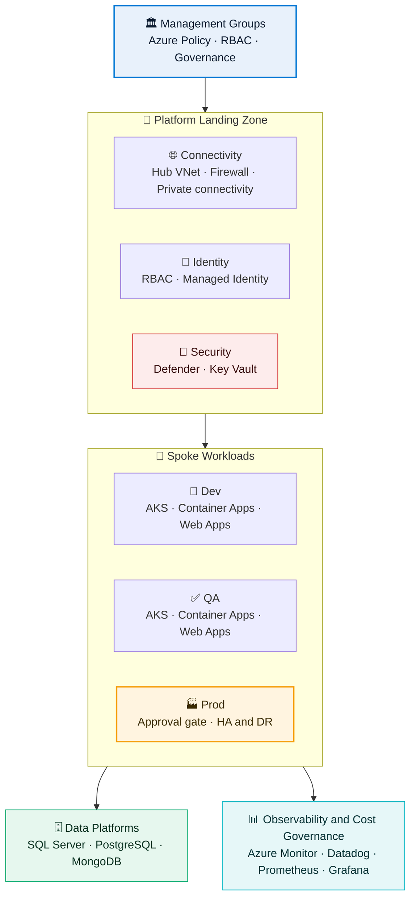
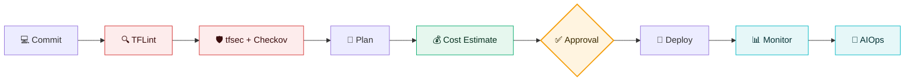
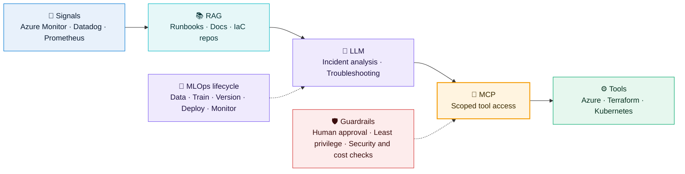

<h1 align="center">Pappu Singh</h1>

<h3 align="center">Lead DevSecOps Engineer | Cloud Security &amp; Cost Optimization Expert</h3>

 

 

# 👋 Hi, I'm Pappu Singh

> **Lead DevSecOps Engineer** building secure, scalable and cost-optimized cloud platforms on Microsoft Azure.

| 🎯 Role | 🔐 Expert In | 🗄️ Databases | 🌱 Exploring |
|:---:|:---:|:---:|:---:|
| **Lead DevSecOps Engineer** | **Cloud Security** **Cost Optimization (FinOps)** | **SQL Server** **PostgreSQL** **MongoDB** | **AIOps · MLOps** **LLMs · RAG · MCP** |

 

# 💎 About Me

I specialize in designing **secure, scalable, cost-optimized and automated cloud platforms on Microsoft Azure**, with deep expertise in **cloud security, cost optimization (FinOps) and database administration**.

I enjoy building **production-grade CI/CD pipelines, Infrastructure as Code, Kubernetes platforms, DevSecOps automation, cloud governance, enterprise landing zones and secure, right-sized architectures**, backed by hands-on **Microsoft SQL Server, PostgreSQL and MongoDB** expertise.

 

# 🚀 Core Expertise

<table>
<tr>
<td width="50%" valign="top">

- ☁️ Enterprise Azure Landing Zone (CAF)
- 🏗️ Terraform Modular Infrastructure
- ⚙️ Azure DevOps & GitHub Actions
- ☸️ AKS & Container Platforms
- 🔐 DevSecOps & Cloud Security
- 💰 Cloud Cost Optimization & FinOps

</td>
<td width="50%" valign="top">

- 🛡️ Azure Governance & Policy
- 🌐 Hub-Spoke Networking
- 🗄️ Database Administration
- 📊 Observability & Monitoring
- ♻️ Disaster Recovery & Business Continuity
- 🤖 Infrastructure Automation

</td>
</tr>
</table>

 

# 🛠️ Technology Stack

  

<table>
<tr>
<td width="50%" valign="top">

### ☁️ Cloud & Architecture

</td>
<td width="50%" valign="top">

### ⚙️ DevOps & IaC

</td>
</tr>
<tr>
<td width="50%" valign="top">

### 🔐 Security

</td>
<td width="50%" valign="top">

### 💰 Cost Optimization

</td>
</tr>
<tr>
<td width="50%" valign="top">

### 🐳 Containers & Kubernetes

</td>
<td width="50%" valign="top">

### 📊 Monitoring

</td>
</tr>
</table>

 

# 🗄️ Database Expertise

  
  
  
  

- 🟥 **Microsoft SQL Server:** administration, performance tuning, backup & recovery, high availability and security hardening
- 🐘 **PostgreSQL:** installation, configuration, replication, tuning and secure access management
- 🍃 **MongoDB:** deployment, replica sets, indexing, performance and data protection
- 🔐 **Database security:** least-privilege access, encryption and auditing
- 💰 **Database cost optimization:** right-sizing, storage and licensing awareness

 

# 🔄 How I Build

> Every change is scanned, cost-checked and approved before it reaches Azure.

- 🛡️ Shift-left security with **TFLint, tfsec and Checkov** on every change
- 🔑 Secret scanning, policy and governance, least privilege and network segmentation
- 📐 Terraform cost estimation inside pipelines, before deployment
- ✅ Approval-gated production deployments

 

# 🌱 Currently Exploring

 

- 🤖 **AIOps** for intelligent DevOps automation
- 🧠 **MLOps** workflows and ML platform engineering
- 🦙 **Large Language Models (LLMs)**
- 📚 **Retrieval Augmented Generation (RAG)**
- 🔗 **Model Context Protocol (MCP)**
- ☁️ **AI-driven Cloud Operations**

 

# 🎯 Professional Highlights

- 🏢 **Lead DevSecOps Engineer**
- ☁️ Microsoft Azure Specialist
- 🏗️ Terraform Enterprise Architectures
- 🔐 **Security Expert:** Secure CI/CD & DevSecOps Automation
- 💰 **Cost Optimization Expert:** FinOps & Cost-Aware Design
- 🗄️ **Database Expertise:** SQL Server, PostgreSQL & MongoDB
- 🌐 Hub-Spoke & Zero Public Exposure Designs
- 📊 Enterprise Monitoring & Observability
- ♻️ Disaster Recovery & High Availability Planning

 

# 📈 GitHub Stats

 

# 📫 Let's Connect

I'm open to conversations on **cloud security, cost optimization, DevSecOps, infrastructure automation, Kubernetes, databases, AIOps and AI-driven operations**.

  

